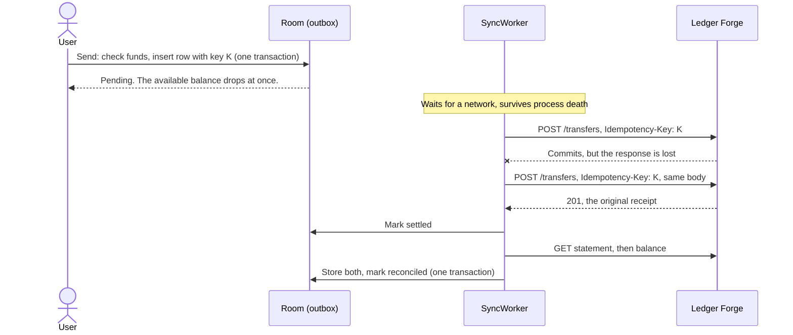
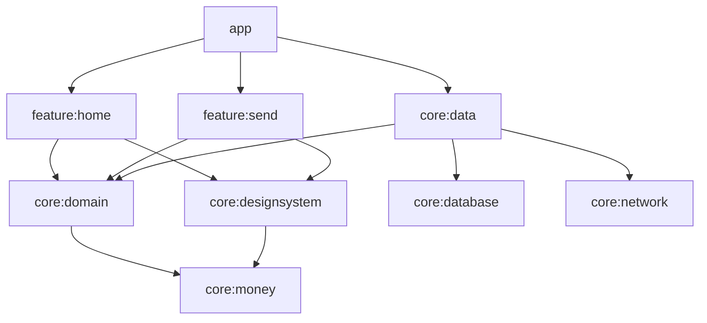

# Forge Wallet

An offline-first Android wallet built on [Ledger Forge](https://github.com/gunnarwrld/ledger-api).
Turn on airplane mode, send money, kill the app and go back online: the transfer settles
exactly once, and Ledger Forge's statement proves it.

> **Status:** the payment path works end to end against the real server, with minimal UI. The
> full send flow, biometric step-up and the design system come next.
> [What's been verified, and what hasn't](docs/verification.md).

## How "exactly once" works



The phone delivers at least once and Ledger Forge applies at most once, so each transfer moves
money exactly once. [ADR 0001](docs/adr/0001-exactly-once-payments.md) covers the response rules,
the failure cases, and the alternatives that were rejected.

## Run the demo

You need Docker, a running emulator, and JDK 21 or newer (Android Studio's bundled JDK works).

Start Ledger Forge from a clone of [`ledger-api`](https://github.com/gunnarwrld/ledger-api):

```bash
docker compose up -d --build
```

Install the app from this repo:

```bash
./gradlew installDebug
```

1. Open the app and **allow** the permission prompt, then tap **Create demo wallets**.
2. Turn on airplane mode, then send money. It shows as pending and the available balance drops.
3. Swipe the app away. Don't force stop it: that cancels its scheduled work until the next launch.
4. Turn airplane mode off. The transfer settles without reopening the app.
5. Check the ledger, from the `ledger-api` folder: one transfer, however many times the request
   was sent.

```bash
docker compose exec postgres psql -U ledger -d ledger -c "select name, balance_minor from accounts where kind = 'CUSTOMER_WALLET'; select count(*) as transfers from journal_entries where entry_type = 'TRANSFER'"
```

The prompt is there because of Android 17: `10.0.2.2`, the emulator's route to your machine, is a
private address, and apps targeting API 37 need `ACCESS_LOCAL_NETWORK` to reach one. Without it,
sockets just time out with no error saying why. Only debug builds ask for it.

[`scripts/verify_exactly_once.sh`](scripts/verify_exactly_once.sh) runs this and two harder cases
for you, including a response lost after the ledger commits, and checks the results in the database.

## Modules



| Module | Contents |
|---|---|
| `app` | Hilt root, Navigation 3 back stack, WorkManager setup |
| `feature:home`, `feature:send` | Screens and ViewModels. They only see `core:domain` and the design system. |
| `core:domain` | Models, repository interfaces, the `SendMoney` use case. Pure Kotlin. |
| `core:data` | The sync worker, the outbox rules and the repository |
| `core:database` | Room: accounts, outbox, statement lines |
| `core:network` | Retrofit client and the rules for reading Ledger Forge's responses. Pure Kotlin. |
| `core:money` | `Money` in `Long` minor units, ISO 4217 exponents, exact parsing, locale formatting. Pure Kotlin. |
| `core:designsystem` | Theme, spacing tokens, `AmountText` with tabular figures |
| `core:testing` | `FakeLedger`, a fault-injecting Ledger Forge, plus shared fakes |
| `build-logic` | Convention plugins for AGP 9.5 (built-in Kotlin) |

## Build and test

```bash
./gradlew assembleDebug                   # debug APK
./gradlew unitTest                        # host unit tests in every module (JVM and Robolectric)
./gradlew ktlintCheck detekt lintDebug    # static analysis, as CI runs it
```

**Stack:** Kotlin 2.4, AGP 9.5, Jetpack Compose with Material 3, Navigation 3, Hilt, Room,
WorkManager, Retrofit and OkHttp. Tests use JUnit 4, kotest-property, Robolectric, Turbine and
MockWebServer. ktlint, detekt and Kover match Ledger Forge.
